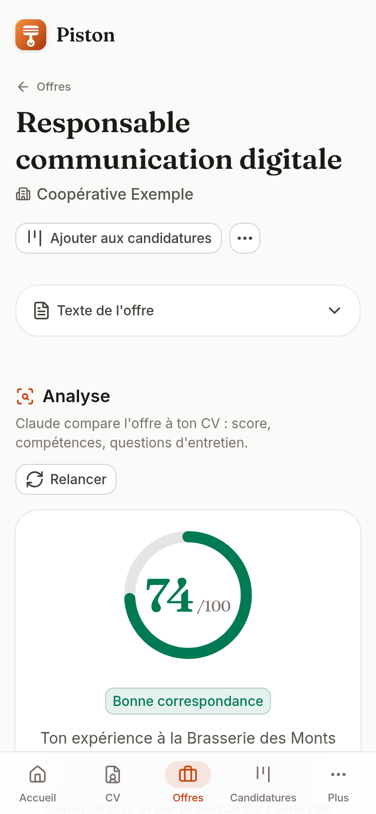
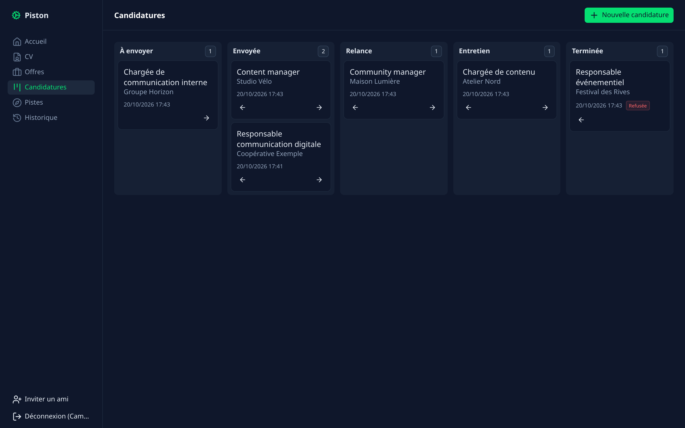
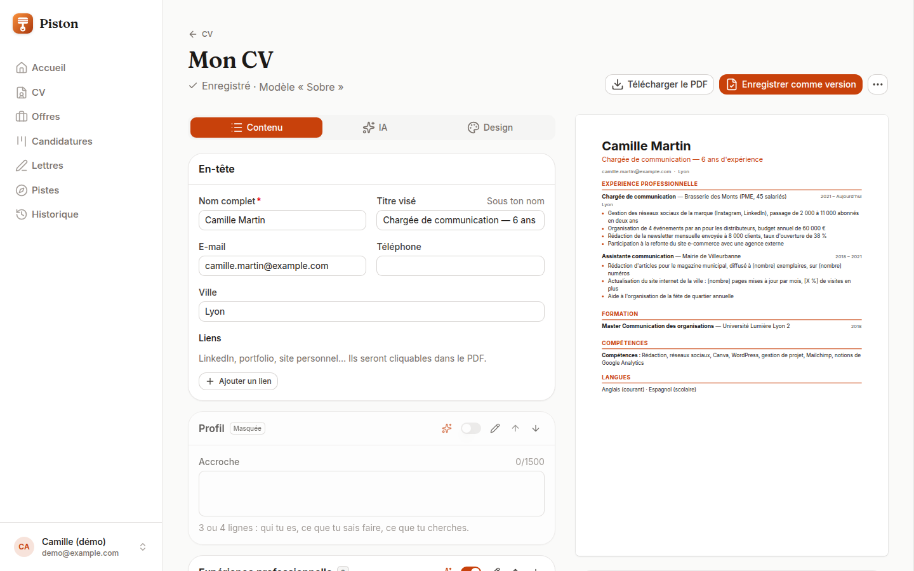

# Piston

[](https://github.com/Faudil/piston/actions/workflows/ci.yml)
[](LICENSE)


**A self-hosted, invite-only job-search copilot powered by Claude.** Piston gives a small group of friends a frank review of their resume, an honest reading of job offers, cover letters without the clichés, fresh search leads, and a kanban to track applications. The interface and Claude's answers are in French.

<p align="center">
  
  
</p>
<p align="center">
  
</p>
<p align="center"><sub>Screenshots use the fictional demo profile from the seed script and illustrative results.</sub></p>

## Features

| Feature                   | What you get                                                                                                                                                                                                                                                                                                                                                                  |
| ------------------------- | ----------------------------------------------------------------------------------------------------------------------------------------------------------------------------------------------------------------------------------------------------------------------------------------------------------------------------------------------------------------------------- |
| **Resume profiles**       | One CV per specialty (« Communication », « Marketing digital »…), each with its own versions and reviews; each offer picks its CV, the default profile otherwise                                                                                                                                                                                                              |
| **CV builder**            | « Créer mon CV »: a structured CV from your resume or a six-question interview, three PDF templates (ATS-readable text, embedded fonts, links), live checks, and Claude's edits (rewrite, shorten, quantify with placeholders, translate, tailor to an offer, apply the review) proposed as a diff you accept line by line; saved as a resume version for every other feature |
| **Resume review**         | A score out of 10 for readability, impact, keywords and consistency; an ATS-filter check (score out of 100 and a checklist, judged from the resume text); 5 strengths and 5 fixes, each quoting your resume; a line-by-line rewrite                                                                                                                                           |
| **Offer analysis**        | A match score out of 100, an ATS keyword match (found and missing keywords), matching and missing skills backed by your actual experience, 5 likely interview questions, HR jargon translated                                                                                                                                                                                 |
| **Cover letter**          | 5 templates × 3 tones, from an application and its notes; edit in place, regenerate a paragraph or ask for corrections; every version kept                                                                                                                                                                                                                                    |
| **Search leads**          | 5 adjacent jobs you have not held yet, 10 job-board keywords, 5 kinds of companies to target                                                                                                                                                                                                                                                                                  |
| **Application tracking**  | A five-column kanban with drag-and-drop (and keyboard controls), notes, and the date of every status change                                                                                                                                                                                                                                                                   |
| **Web search** (optional) | Search live offers on French job boards and import an offer from its link, through [Tavily](https://tavily.com) (needs `TAVILY_API_KEY`)                                                                                                                                                                                                                                      |
| **History**               | Every Claude output is stored and can be reopened                                                                                                                                                                                                                                                                                                                             |

The main flow — paste an offer, read the analysis, generate the letter, tweak it, add it to the kanban — happens on a single page and takes under two minutes on a phone.

## Self-host in 3 commands

You need Docker and an [Anthropic API key](https://console.anthropic.com).

```bash
git clone https://github.com/Faudil/piston.git && cd piston
cp .env.example .env   # set ANTHROPIC_API_KEY, NUXT_SESSION_PASSWORD and POSTGRES_PASSWORD
docker compose up -d --build
```

Optionally set `TAVILY_API_KEY` to enable job search and offer import from a link. Piston is now on port 3000. There is no public sign-up: get the first invitation link from the logs with `docker compose logs web | grep invite`, then invite your friends from the app. Serve it over HTTPS behind a reverse proxy.

See [docs/GETTING_STARTED.md](docs/GETTING_STARTED.md) for local development, configuration and troubleshooting.

## How it works

```
Browser (Vue, Nuxt UI) ──fetch + SSE──▶ Nitro API routes ──▶ Claude (Anthropic SDK, streaming)
                                              │
                                              └──▶ PostgreSQL (Drizzle ORM)
```

- **One Nuxt 4 app** serves both the Vue frontend and the API (Nitro routes in `apps/web/server/api`). No separate backend.
- **Streaming.** `/api/generate/*` routes stream Claude's answer to the browser over Server-Sent Events, then save the full generation. Structured results (scores, lists) are parsed while they stream, so they fill in progressively.
- **Structured outputs.** Each feature defines a Zod schema in `@piston/shared`; it is sent to the API as the output format and used again to validate and type the result.
- **Prompt caching.** The system prompt and the resume are cache breakpoints, since they repeat across a user's calls; only the offer and options change.
- **AI edits as a reviewable diff.** In the CV builder, Claude never rewrites the document: it returns typed operations on item ids (`set_bullet`, `add_item`, `move_section`...) that the user accepts or rejects one by one, applied by pure functions in `@piston/shared`. PDFs are rendered with pdfmake and previewed with pdf.js, so the preview is the downloaded file. See [docs/design/cv-builder.md](docs/design/cv-builder.md).
- **Prompt-injection guard.** The resume and offer are wrapped in `<cv>` and `<offre>` tags, closing tags inside them are escaped, and the prompts state that their content is data, never instructions.
- **Guardrails.** Invite-only accounts, scrypt-hashed passwords, httpOnly session cookies, every query scoped to the logged-in user, input size limits, and 30 generations per user per 24 hours.

The non-obvious choices are documented in [docs/DECISIONS.md](docs/DECISIONS.md).

## Stack

| Layer       | Choice                                                                                  |
| ----------- | --------------------------------------------------------------------------------------- |
| Runtime     | [Bun](https://bun.sh) 1.3 (install, scripts, tests, production server)                  |
| Monorepo    | Bun workspaces + [Turborepo](https://turbo.build)                                       |
| App and API | [Nuxt 4](https://nuxt.com) (Vue 3, Nitro, h3), TypeScript strict                        |
| UI          | [Nuxt UI](https://ui.nuxt.com) + Tailwind CSS                                           |
| Database    | PostgreSQL 17 + [Drizzle ORM](https://orm.drizzle.team)                                 |
| AI          | [Claude](https://docs.anthropic.com) via `@anthropic-ai/sdk`, model `claude-sonnet-5-5` |
| Validation  | [Zod](https://zod.dev), on every route                                                  |
| Auth        | [nuxt-auth-utils](https://github.com/atinux/nuxt-auth-utils), invitation links          |
| Tests       | Vitest, PGlite (in-memory Postgres), mocked Anthropic SDK                               |
| Quality     | ESLint, Prettier, Husky, GitHub Actions                                                 |
| Web search  | [Tavily](https://tavily.com) REST API through `fetch`, optional                         |
| Deployment  | Docker multi-stage image + Docker Compose                                               |

## Repository layout

```
apps/web/          Nuxt app: pages and components (app/), API routes and utils (server/)
packages/db/       Drizzle schema, migrations, seed and invite scripts
packages/prompts/  Claude system prompts, one pure function per feature, snapshot-tested
packages/shared/   Zod schemas and types shared by the client, the API and the prompts
docs/              Getting started, design decisions, design docs (docs/design)
```

## Development

```bash
bun install
docker compose -f docker-compose.dev.yml up -d
bun run db:migrate && bun run db:seed
bun dev
```

`bun run lint` and `bun run test` check everything; tests need neither Docker nor an API key. See [CONTRIBUTING.md](CONTRIBUTING.md).

## Cost

With `claude-sonnet-5-5` ($2 per million input tokens, $10 per million output tokens), a resume review or an offer analysis costs around one to three cents; cached resume tokens are billed at a fraction of the price. Each generation's token usage is shown in the history.

## License

[MIT](LICENSE)
